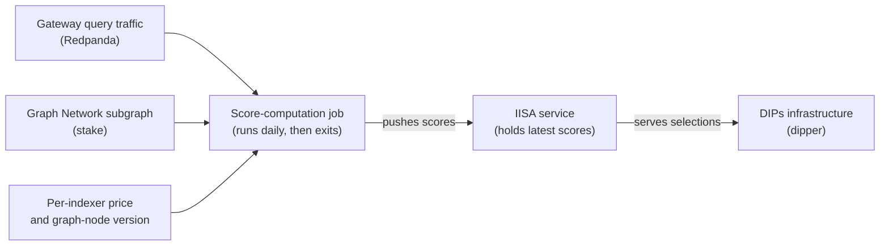

# Subgraph DIPs Indexer Selection

**Choosing which indexers earn paid indexing agreements on The Graph**

 

[At a glance](#at-a-glance) | [Background](#background) | [What it produces](#what-it-produces) | [How it works](#how-it-works) | [Measuring](#measuring-indexers) | [Choosing](#choosing-indexers) | [Repository layout](#repository-layout)

---

The Indexing Indexer Selection Algorithm (IISA) for The Graph's Direct Indexing Payments service. It decides which indexers should be selected to index and serve a given subgraph deployment, ranking every candidate by a weighted blend of quality and economic signals drawn from real query traffic and on-chain stake.

---

## At a glance

| Question | Answer |
|---|---|
| **What this service decides** | Which indexers should hold the paid agreements for each subgraph deployment |
| **Who asks it** | The DIPs gateway service, [dipper](https://github.com/edgeandnode/dipper), over HTTP |
| **When scores refresh** | Once a day, when the measurement job replays recent gateway query traffic |
| **What is measured** | Economic security, price, latency, uptime, freshness, success rate |
| **How an indexer scores well** | Serve queries reliably and quickly, price competitively, keep `graph-node` current |

---

## Background

The Graph is a decentralised network where independent operators, called *indexers*, organise blockchain data into *subgraphs* and answer queries against them. Most of an indexer's income comes from protocol indexing rewards, which are spread across the whole network. Direct Indexing Payments (DIPs) sit alongside that: indexers are paid a recurring fee — quoted in GRT per 30 days — to commit to indexing and serving a specific subgraph deployment. At first these agreements are funded by the protocol itself.

That arrangement only works if someone decides which indexers should receive those paid agreements, keeps the best-performing ones in place, and replaces the ones that fall behind. Making that decision well is the job of this project.

## What it produces

Given a subgraph deployment and the number of indexers it needs, the service returns the set of indexers that should serve it, each with its price for the requested chain. The answer is a recommendation. The DIPs infrastructure that calls it — a service known as *dipper* — compares the recommendation against the agreements that already exist and works out which to add and which to cancel. This project never signs or cancels an agreement itself; it only advises, so the answer can also shift between calls as fresh scores arrive.

## How it works

The system has two cooperating parts that share nothing on disk. A daily score-computation job measures how every indexer has actually been performing and pushes the results to the service. A long-running HTTP service keeps the latest scores in memory and answers selection requests. The job sends its results to the service over the network, and the service is the single owner of the data it serves. Both run on Kubernetes — the service as a long-lived deployment, the measurement work as a scheduled job that runs once a day and then exits.

### Measuring indexers

Once a day the job replays roughly the last few weeks of real gateway query traffic from a Redpanda (Kafka) topic — a window the operator can widen or narrow — and combines it with live stake data from the Graph Network subgraph and a fresh price quote fetched from each indexer. From that it derives, for every indexer:

- **Economic security** — slashable stake measured against the query fees the indexer has earned. More stake standing behind fewer fees means more to lose by misbehaving.
- **Price** — what the indexer charges to serve the deployment, quoted both per 30 days and per billion entities served.
- **Latency** — how quickly it answers, estimated with a regression that accounts for the geographic distance between the indexer and where queries originate.
- **Uptime** — how much of the observed window the indexer was available.
- **Success rate** — the share of its queries that returned a usable result.

Because the traffic is enormous, the job samples it instead of reading every record, and balances the sample so each indexer is represented fairly rather than being drowned out by the busiest ones. The sampling is seeded, so a given seed and the same input reproduce the same scores.

The measurement is built to degrade rather than disappear. If geographic lookups are unavailable it falls back to neutral latency scores; if stake cannot be read, it reuses the stake and fees the service holds from a run that read them, for up to 60 hours, since they barely move in a day, and leaves out any indexer it has no reading for beside those it has; if the wider pipeline fails it publishes today's prices with the quality, stake and fees the service holds from a run that measured them, again for up to 60 hours, and only with nothing recent to carry over does it publish real prices with equal quality scores rather than going dark. It can also be told to exclude any indexer running below a minimum `graph-node` version, so stale software does not win paid work.

### Checking freshness (off by default)

The sync-status fetcher can also check, once a minute, that each indexer serves fresh data on every chain it offers DIPs on and has priced, among the networks in The Graph's networks registry. For each indexer and chain it picks at random 1 subgraph the indexer first allocated to at least `FRESHNESS_MIN_ALLOCATION_AGE_DAYS` days ago (7 by default) and still has open, asks the indexer for that subgraph's latest block through the gateway, as a customer's query would reach it, and counts the answer as fresh when the block is at most `FRESHNESS_BAR_SECONDS` old (36 by default). Each minute's outcomes go to the service about 30 seconds after the minute ends. A failure on the gateway's side or the fetcher's own is reported as void rather than held against the indexer, and so is a minute in which most indexers didn't answer at all. The block time comes from the indexer's own signed answer, so the check catches an indexer that is behind, but not one that changes its software to report a false block time.

2 more rules keep an indexer from being marked down for something that isn't its fault. When an indexer refuses the gateway's payment, the check is void, with a warning in the log naming the indexer at most once every 10 minutes: the indexer may be owed more than the gateway's escrow holds, which IISA can't see, so a refusal can't be shown to be the indexer's fault. When an indexer is behind on a subgraph, up to 3 other indexers allocated to that subgraph are asked the same question. If at least 2 indexers are behind on it while fresh on another subgraph of the same chain, and no indexer has answered fresh on it in the last 10 minutes, the subgraph is broken for everyone, so it is left out of every indexer's checks for an hour and the stale answers on it are void. Being behind on every subgraph doesn't count, since that is what an outage at a shared RPC provider looks like. A subgraph found not broken isn't asked about again for 10 minutes, and nor is one that any indexer answered fresh on in the last 10 minutes. Each of those extra questions waits at most 10 seconds for an answer, and a verdict that arrives after its minute has been pushed leaves that minute's fail standing, though the subgraph is still left out from then on.

It runs only when `FRESHNESS_PROBE_ENABLED` is `true`. It then needs `FRESHNESS_GATEWAY_URL`, the gateway's base address such as `https://gateway.thegraph.com/api`, and `FRESHNESS_GATEWAY_API_KEY`, and the fetcher refuses to start without them. Every check is a paid query, so switching it on spends query fees on that API key, about 1,440 queries a day for each indexer and chain, plus up to 7 more for each stale answer that asks other indexers, with at most 20 of those a minute. `FRESHNESS_REFRESH_INTERVAL` (900 seconds) sets how often it re-reads which indexers and subgraphs to check, `FRESHNESS_REQUEST_TIMEOUT` (25 seconds) how long a check waits for an answer, and `FRESHNESS_MAX_CONCURRENCY` (50) how many checks run at once. The fetcher's `/health` body shows when the last minute was pushed.

If the prober stops unexpectedly, the fetcher's `/health` answers 503 so the pod is restarted. A prober that runs but can't push, because the service or the gateway is down, leaves the answer alone, so someone else's outage doesn't restart the pod over and over.

Only chains in The Graph's networks registry are checked, since those are the only chain names a selection can ask about, and a made-up name in an indexer's list is left out with a warning. The fetcher reads the registry from `FRESHNESS_NETWORKS_REGISTRY_URL`, by default The Graph's own copy with the copy on GitHub as a fallback, before its first check and then every 6 hours. When a read fails it keeps the last copy that loaded, and until one has loaded it checks nothing. `FRESHNESS_ADDITIONAL_NETWORKS` adds comma-separated chain names the registry lacks, such as a test chain, and `/health` shows when the registry last loaded and how many networks it holds.

### Choosing indexers

When asked to fill a deployment, the service blends each indexer's measurements into a single weighted score:

| Signal | Better | Weight |
| --- | --- | --- |
| Economic security (stake-to-fees) | higher | 0.25 |
| Price (per 30 days) | lower | 0.25 |
| Latency | lower | 0.10 |
| Uptime | higher | 0.15 |
| Freshness | higher | 0.15 |
| Success rate | higher | 0.05 |
| Price (per billion entities) | lower | 0.05 |

*Better* is the direction that earns a higher score: latency and price are inverted during scoring, so a lower raw value scores higher. These are the weights selection always uses: the source of truth is `DEFAULT_WEIGHTS` in `src/iisa/indexer_selection.py`, and a selection request has no way to change them.

From those scores it selects the number of indexers the caller asks for, shaped by a handful of constraints. It stays within the price ceiling the caller specifies and skips indexers that do not serve the requested chain. When more than one indexer is needed it tries to spread them across distinct operators and locations, falling back to the best available when no combination satisfies that. When it knows which indexers are already synced to the deployment, it favours them, so queries can be served the moment an agreement is accepted. An indexer counts as synced on a deployment only when its own server says so and it also holds an active allocation on that deployment on-chain: the hourly sync-status fetcher checks each claim against the Graph Network subgraph, since a claim alone would let any indexer list every deployment. Given a gateway address and API key (`IISA_SYNC_CHECK_GATEWAY_URL` and `IISA_SYNC_CHECK_GATEWAY_API_KEY`), the service also checks a candidate's claim at the moment it could win the candidate a place: when a selection looks for an indexer to add or swap in, it asks every candidate that could be picked ahead of the rest on its claim, all at once and through the gateway as a paying customer would, for the deployment's latest block, and confirms a claim only if the indexer signed the answer and the block is at most `IISA_SYNC_CHECK_BAR_SECONDS` old (36 by default). A candidate is asked only when being synced could decide the pick: it must leave the group spread over 2 operators and 2 locations, beat a member it would replace by the replacement margin, and score at least 0.60 once the group, counting indexers picked earlier in the same selection, has a synced indexer. Indexers already in the group are never asked: their claims count as given. If any claim asked is not confirmed within `IISA_SYNC_CHECK_TIMEOUT_SECONDS` (5 by default), for any reason including an unreachable gateway, selection decides again counting only the members' claims and the confirmed ones, so every other candidate competes on its score. At most 50 candidates are asked for 1 selection, best scores first; with more, the rest are left unasked and selection also decides again. It leaves a working incumbent in place, stepping in only once the group is already at its target size and an incumbent has dropped well below an acceptable score while a challenger beats it by a clear margin — so the set does not churn on small fluctuations. And it never picks an indexer the caller has blocked. The exact thresholds behind these rules live alongside the weights in `src/iisa/indexer_selection.py`.

Economic security is scored by placing each indexer's stake-to-fees ratio on a straight line between the lowest and the highest ratio among the indexers the request can keep or pick, with no cap on how far the highest can stretch that line. The fees are the query fees the indexer has earned plus, when dipper sends them with the request, the DIPs fees dipper expects it to earn from its active agreements. This is a deliberate choice, and it has a consequence worth knowing: 1 indexer with an extremely high ratio pushes everyone else's score on this signal towards 0. With 4 indexers at ratios of 500, 1,000, 2,000 and 5,000, they score 0, 0.11, 0.33 and 1; add a fifth at 1,000,000,000,000 and the first 4 all score effectively 0 while it scores 1. Since this signal carries 25% of the weight, it alone then puts the outlier up to 0.25 ahead of everyone else in the weighted score, and the rest are told apart only by the other 75%. The choice is kept because the outlier really does put more stake behind each unit of fees than any other indexer can, so its lead reflects a real difference rather than a fault in the measurement. An indexer with neither query fees nor expected DIPs fees has no ratio, and scores the maximum of 1; it is placed just above the highest real ratio, so it does not push the others down the way an extreme ratio does.

### Freshness

An indexer can keep answering queries while it has stopped following a chain, so none of the other scores above notice it serving stale data. To catch that, a prober checks once a minute whether each indexer is serving up-to-date data on each chain it offers DIPs on, and sends that minute's outcomes to `POST /freshness`. Each outcome is checked on its own: one that breaks the rules for an outcome, or repeats an indexer and chain already in the push, is left out, counted in the answer's `refused` and noted in a warning, and the rest of the minute still counts. The service keeps them in `freshness.json` on its volume, and `GET /freshness` reports, for each indexer on each chain, its latest outcome, how it did over the last 10 minutes and its passed and counted checks over the last 28 days.

From the last 10 minutes the service works out a stale mark. An indexer is marked on a chain when it passed fewer than half of the minutes that counted. A minute the service never received, or a check voided by a fault on IISA's or the gateway's side, doesn't count; a minute the service received without an outcome for the indexer counts as not passed if it came before the indexer's first outcome, and doesn't count after that, so a push that leaves indexers out doesn't mark them. When fewer than 5 minutes counted, the mark stays as it was. An indexer seen for the first time starts marked, so it has to pass checks before the mark clears.

Every refused payment is void, and a void minute never changes a mark, so an indexer whose checks are all void keeps its last mark. One that was unmarked stays pickable for as long as it refuses the prober's queries, and one first seen while refusing them stays marked. The only sign of either is the fetcher's warning about refused payments, which names the indexer at most once every 10 minutes.

The mark changes selection on every chain except those listed, comma-separated, in `IISA_FRESHNESS_EXEMPT_CHAINS`, which is empty by default. On a chain that isn't exempt, an indexer that is marked, or that has no freshness record yet, isn't picked for new agreements and doesn't set the scale the other candidates are scored on, the way an indexer that declined the subgraph is treated. Since a stale candidate drops out of the rows the other indexers are scaled against, exactly as a declined one does, the score of an indexer already in the group can shift a little when that happens. The mark never takes an agreement away from an indexer that already holds one. On an exempt chain the mark is only recorded and reported. On a chain where no indexer's allocation is old enough to be checked yet (7 days by default), every check finds no evidence, which counts as not passed, so every indexer there is marked and nobody new is picked there until an allocation is old enough or the chain is exempted.

Marks only stay trustworthy while checks keep counting, so a chain is enforced only while some check on it counted (passed, failed or found no evidence, rather than being void) within the last `IISA_FRESHNESS_MAX_AGE_MINUTES` minutes by the service's clock, 60 by default. When the prober stops, or keeps pushing but every check is void because the gateway is down or its key is out of funds, the marks stop changing, so once that limit passes the chain is picked from as if it were exempt, and every such selection logs a warning saying how old the last counted check is. A chain with no counted check in the 28 days kept, such as one the prober doesn't check or every chain while the prober is off, is picked from as if it were exempt too, with only a debug line in the log: enforcement waits for checks to arrive rather than leaving nobody to pick. `GET /freshness` lists every chain with freshness records, and every exempt chain, and shows for each whether it isn't exempt (`enforced`), whether its marks are deciding selection right now (`enforcing`) and the last minute a check on it counted (`last_counted_minute`).

Freshness is also 1 of the weighted signals, on the request's chain. An indexer's score there is its share of checks passed over the last 28 days, taken over at least 10,080 checks (7 days of minutes) so a newcomer can't score 1 on a good hour, then raised to the 6th power, so 90% scores about 0.53 and 80% about 0.26. An indexer with no record on the chain scores 0. On a chain whose earliest freshness record is less than 7 days old, or that has none, such as every chain while the prober is off, freshness is left out and the other signals' weights are scaled up to fill its place, rather than every indexer scoring 0. The same goes for a chain whose last counted check is older than `IISA_FRESHNESS_MAX_AGE_MINUTES` by the service's clock, the rule that also stops its marks deciding selection, since the scores only change when checks count: once the prober stops, or every check is void, freshness drops out there until checks count again. Unlike the mark, the weight also applies on an exempt chain. The network-wide parts of `GET /scores/weighted` and `POST /get-score` leave freshness out, as they leave out prices, while each chain's part includes it.

## Repository layout

| Path | What lives there |
| --- | --- |
| `src/iisa/` | The HTTP service: the score cache, the weighting, and the selection logic. |
| `cronjobs/compute_scores/` | The daily measurement job: gateway-traffic replay, metric computation, and the client that pushes scores. |
| `k8s/` | The Kubernetes manifests for the service and the daily job. |
| `tests/` | The service's tests, run in CI against the exact versions pinned in `uv.lock`, which the service image installs, under the Python in `.python-version` that the image runs. |
| `tests/cronjob/` | The daily job's tests, run in CI against what its `requirements.txt` resolves to. |

## Running the tests

`uv sync --extra dev` then `pytest` runs the service's tests. The daily job's tests in `tests/cronjob/` also need its own packages, from `uv pip install -r cronjobs/compute_scores/requirements.txt`; without them `pytest` skips that folder and says so at the top of its output.
